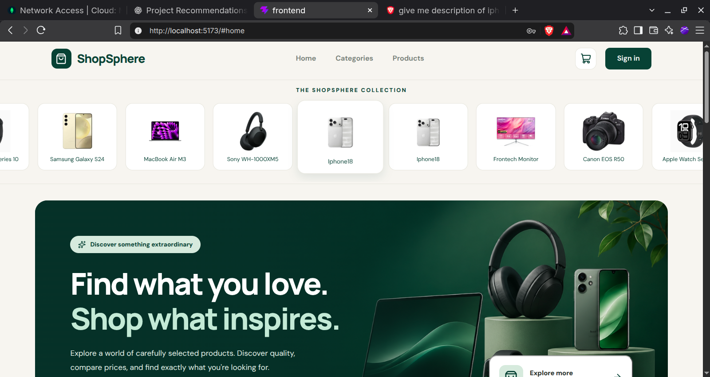
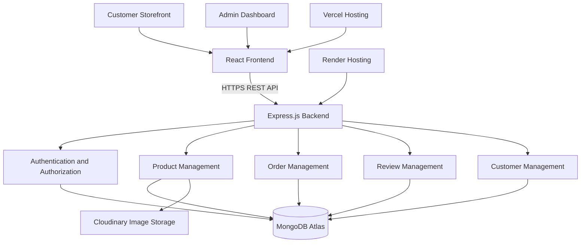
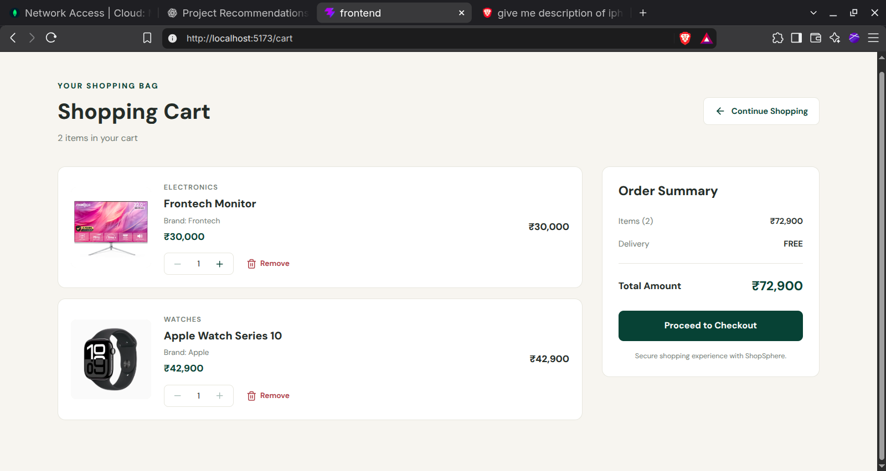
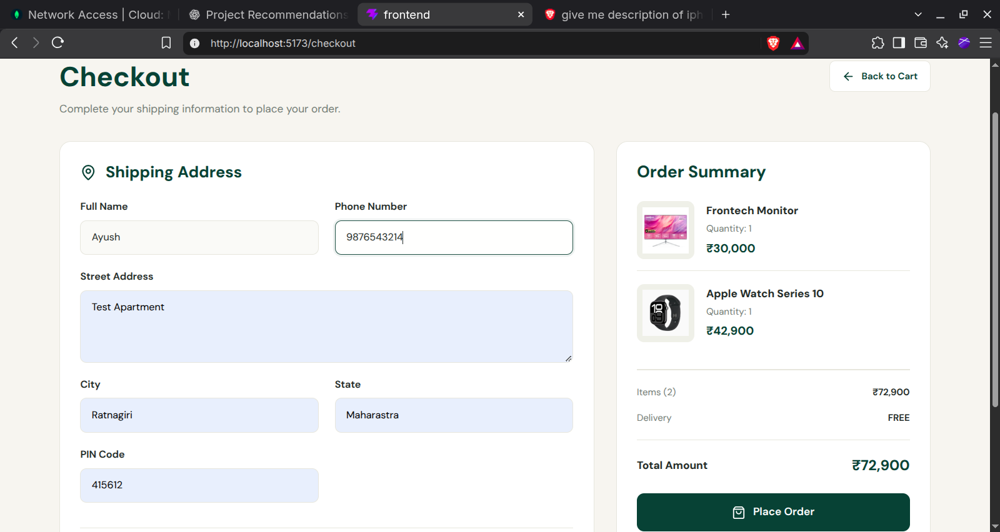
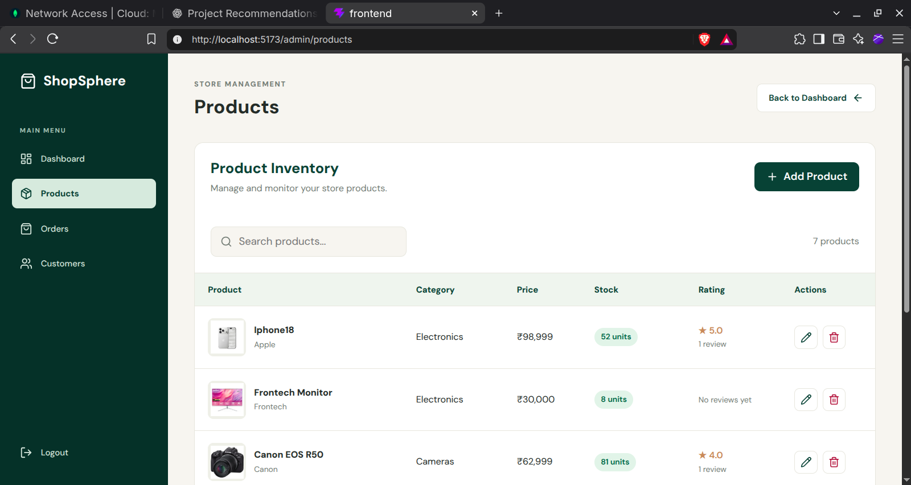
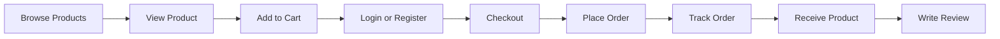
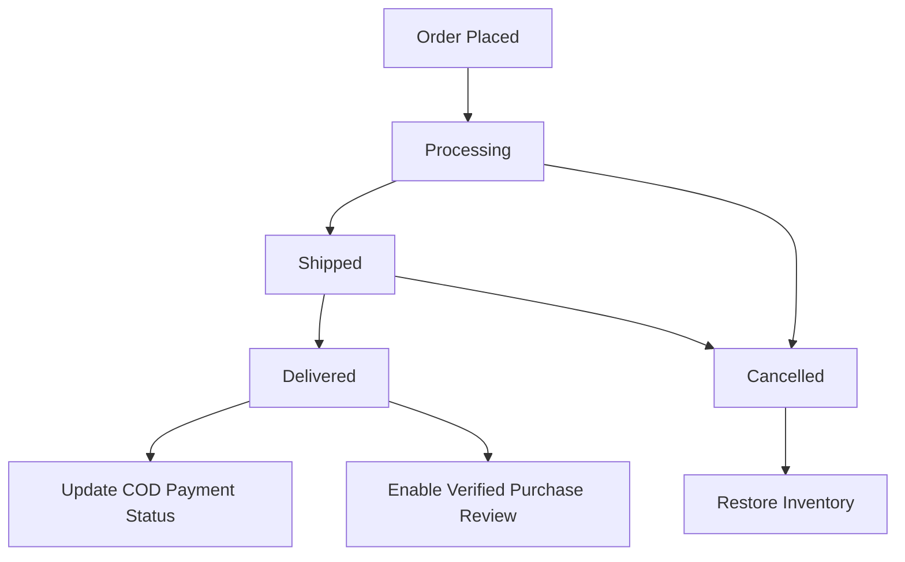

# 🛒 ShopSphere — Full-Stack E-Commerce Platform


## 📖 Overview

**ShopSphere** is a modern, full-stack e-commerce platform built using the MERN stack. It provides a responsive shopping experience with product discovery, customer authentication, cart management, order processing, verified purchase reviews, and a comprehensive administrative dashboard.

The platform integrates RESTful APIs, role-based access control, cloud-based image storage, inventory management, and production deployment.

Developed as part of the **Full-Stack Development Internship at CodeC Technologies**.



---

## 🌐 Live Demo

| Resource | Link |
|----------|------|
| Live Website | [Visit ShopSphere](https://shop-sphere-liard-two.vercel.app/) |
| GitHub Repository | [View Source Code](https://github.com/Tribalchiefcoder/ShopSphere) |
| Backend API | [ShopSphere API](https://shopsphere-backend-ra7g.onrender.com/) |
| API Health Check | [Check API Status](https://shopsphere-backend-ra7g.onrender.com/api/health) |

> The backend is hosted on Render's free tier. The initial request may take longer due to server cold starts.

---

## ✨ Key Features

### Customer Storefront

- Modern and responsive user interface
- Customer registration and authentication
- Product search and category-based filtering
- Price range filtering, sorting, and pagination
- Detailed product pages with image galleries
- Related product recommendations
- Persistent shopping cart
- Stock-aware quantity management
- Checkout with shipping address validation
- Cash on Delivery payment option
- Personal order history
- Order status tracking
- Verified purchase reviews and ratings
- Review editing and deletion
- Desktop and mobile compatibility

### Admin Dashboard

- Dedicated administrator authentication
- Role-based access control
- Business overview and dashboard statistics
- Product creation, editing, and deletion
- Multiple product image uploads
- Cloudinary image storage integration
- Inventory and low-stock monitoring
- Order management and status updates
- Customer management
- Customer search functionality
- Automatic stock deduction during order placement
- Automatic stock restoration upon cancellation
- Product review and rating insights

### Security and Reliability

- JWT-based authentication
- Password hashing using bcrypt
- Role-based authorization
- Protected administrative API routes
- Customer-specific order access
- Review ownership validation
- Verified purchase validation
- Server-side input validation
- Helmet HTTP security headers
- API request rate limiting
- Authentication rate limiting
- Restricted CORS configuration
- JSON request size limits
- Centralized error handling
- Environment variable protection
- API health monitoring endpoint

---

## 🛠️ Technology Stack

| Category | Technologies |
|----------|-------------|
| Frontend | React.js, Vite, CSS3 |
| Routing | React Router |
| State Management | React Context API, React Hooks |
| HTTP Client | Axios |
| Icons | Lucide React |
| Backend | Node.js, Express.js |
| Database | MongoDB Atlas |
| ODM | Mongoose |
| Authentication | JSON Web Token (JWT) |
| Password Security | bcryptjs |
| Image Upload | Multer |
| Cloud Storage | Cloudinary |
| API Security | Helmet, CORS, Express Rate Limit |
| API Testing | Postman |
| Version Control | Git and GitHub |
| Frontend Hosting | Vercel |
| Backend Hosting | Render |

---

## 🏗️ System Architecture



ShopSphere follows a client-server architecture in which the React frontend communicates with an Express REST API. MongoDB Atlas provides persistent database storage, while Cloudinary handles uploaded product images.

---

## 📸 Project Screenshots

### Customer Storefront

#### 1. Homepage

Modern storefront featuring a premium hero banner, product categories, navigation, and product discovery.


#### 2. Product Catalog

Product browsing with category filters, price filters, search, sorting, and pagination.


#### 3. Product Details

Detailed product information, image gallery, pricing, stock availability, and shopping options.


#### 4. Product Reviews

Customer ratings, verified purchase reviews, and product feedback.


#### 5. Shopping Cart

Persistent cart with quantity management, product removal, and order summary.



#### 6. Checkout

Shipping information, order summary, and Cash on Delivery checkout.



#### 7. My Orders

Customer order history with order details and delivery status.


---

### Admin Panel

#### 8. Admin Dashboard

Centralized administrative overview of products, inventory, orders, and customers.


#### 9. Product Management

Product CRUD operations, image uploads, pricing, and inventory management.



#### 10. Order Management

Order monitoring, status filtering, and order status updates.


#### 11. Customer Management

Customer records and customer search functionality.


---

## 📁 Project Structure

```text
ShopSphere/
│
├── backend/
│   ├── config/
│   │   ├── cloudinary.js
│   │   └── db.js
│   │
│   ├── controllers/
│   │   ├── authController.js
│   │   ├── orderController.js
│   │   ├── productController.js
│   │   ├── reviewController.js
│   │   └── uploadController.js
│   │
│   ├── middleware/
│   │   ├── authMiddleware.js
│   │   └── uploadMiddleware.js
│   │
│   ├── models/
│   │   ├── User.js
│   │   ├── Product.js
│   │   ├── Order.js
│   │   └── Review.js
│   │
│   ├── routes/
│   │   ├── authRoutes.js
│   │   ├── productRoutes.js
│   │   ├── orderRoutes.js
│   │   └── reviewRoutes.js
│   │
│   ├── scripts/
│   ├── .env.example
│   ├── .gitignore
│   ├── package.json
│   └── server.js
│
├── frontend/
│   ├── public/
│   │   ├── images/
│   │   └── favicon.svg
│   │
│   ├── src/
│   │   ├── assets/
│   │   ├── components/
│   │   │   ├── AdminSidebar.jsx
│   │   │   ├── ProductReviews.jsx
│   │   │   └── ProtectedAdminRoute.jsx
│   │   │
│   │   ├── context/
│   │   │   └── CartContext.jsx
│   │   │
│   │   ├── pages/
│   │   │   ├── admin/
│   │   │   ├── auth/
│   │   │   ├── Home.jsx
│   │   │   ├── HomeResponsive.css
│   │   │   ├── ProductDetails.jsx
│   │   │   ├── Cart.jsx
│   │   │   ├── Checkout.jsx
│   │   │   └── MyOrders.jsx
│   │   │
│   │   ├── App.jsx
│   │   ├── App.css
│   │   ├── index.css
│   │   └── main.jsx
│   │
│   ├── .env.example
│   ├── index.html
│   ├── package.json
│   ├── vercel.json
│   └── vite.config.js
│
├── screenshots/
├── .gitignore
├── LICENSE
└── README.md
```

---

## 🗄️ Database Models

| Model | Purpose |
|-------|---------|
| User | Stores customer and administrator accounts, hashed passwords, and roles |
| Product | Stores product information, pricing, images, categories, and inventory |
| Order | Stores purchased products, shipping information, payment status, and order status |
| Review | Stores customer ratings, comments, product references, and purchase verification |

The database uses Mongoose schemas with validation and indexes to support data integrity and efficient queries.

---

## 🔌 REST API Documentation

### Authentication APIs

| Method | Endpoint | Access |
|--------|----------|--------|
| POST | `/api/auth/register` | Public |
| POST | `/api/auth/login` | Public |
| GET | `/api/auth/admin/customers` | Admin |
| GET | `/api/auth/admin/customers/stats` | Admin |

### Product APIs

| Method | Endpoint | Access |
|--------|----------|--------|
| GET | `/api/products` | Public |
| GET | `/api/products/:id` | Public |
| POST | `/api/products` | Admin |
| PUT | `/api/products/:id` | Admin |
| DELETE | `/api/products/:id` | Admin |
| POST | `/api/products/upload` | Admin |

### Order APIs

| Method | Endpoint | Access |
|--------|----------|--------|
| POST | `/api/orders` | Customer |
| GET | `/api/orders/my-orders` | Customer |
| GET | `/api/orders/admin/all` | Admin |
| PUT | `/api/orders/admin/:orderId/status` | Admin |

### Review APIs

| Method | Endpoint | Access |
|--------|----------|--------|
| GET | `/api/reviews/product/:productId` | Public |
| GET | `/api/reviews/eligibility/:productId` | Customer |
| POST | `/api/reviews/product/:productId` | Eligible Customer |
| PUT | `/api/reviews/:reviewId` | Review Owner |
| DELETE | `/api/reviews/:reviewId` | Review Owner |

### System APIs

| Method | Endpoint | Access |
|--------|----------|--------|
| GET | `/` | Public |
| GET | `/api/health` | Public |

Protected endpoints require a valid JWT in the authorization header:

```http
Authorization: Bearer YOUR_JWT_TOKEN
```

---

## 🔄 Application Workflow

### Customer Shopping Workflow



### Order Management Workflow



---

## 🚀 Getting Started

Follow the instructions below to run ShopSphere locally.

### Prerequisites

- Node.js compatible with the project dependencies
- npm
- Git
- MongoDB Atlas account
- Cloudinary account

### 1. Clone the Repository

```bash
git clone https://github.com/Tribalchiefcoder/ShopSphere.git

cd ShopSphere
```

### 2. Backend Setup

Navigate to the backend directory:

```bash
cd backend
npm ci
```

Create an environment configuration file:

```bash
cp .env.example .env
```

Configure the following environment variables:

```env
PORT=5000
MONGO_URI=your_mongodb_connection_string
JWT_SECRET=your_secure_random_secret
CLOUDINARY_CLOUD_NAME=your_cloudinary_cloud_name
CLOUDINARY_API_KEY=your_cloudinary_api_key
CLOUDINARY_API_SECRET=your_cloudinary_api_secret
FRONTEND_URL=http://localhost:5173
NODE_ENV=development
```

Generate a secure JWT secret using:

```bash
node -e "console.log(require('crypto').randomBytes(32).toString('hex'))"
```

Ensure that MongoDB Atlas permits connections from your development environment.

Start the backend server:

```bash
npm run dev
```

The backend will be available at:

```text
http://localhost:5000
```

### 3. Frontend Setup

Open a separate terminal and navigate to the frontend directory:

```bash
cd ShopSphere/frontend
npm ci
```

Create the frontend environment file:

```bash
cp .env.example .env
```

Configure the API URL:

```env
VITE_API_URL=http://localhost:5000/api
```

Start the frontend development server:

```bash
npm run dev
```

The frontend will be available at:

```text
http://localhost:5173
```

### 4. Access the Application

| Service | Local URL |
|---------|-----------|
| Customer Storefront | http://localhost:5173 |
| Admin Login | http://localhost:5173/admin/login |
| Backend API | http://localhost:5000 |
| API Health Check | http://localhost:5000/api/health |

> Admin functionality requires an authorized administrator account. A new database will require product data and administrator setup before all features can be demonstrated.

---

## 🔐 Environment Variables

### Backend

| Variable | Description |
|----------|-------------|
| `PORT` | Backend server port |
| `MONGO_URI` | MongoDB database connection string |
| `JWT_SECRET` | Secure signing key for authentication tokens |
| `CLOUDINARY_CLOUD_NAME` | Cloudinary cloud identifier |
| `CLOUDINARY_API_KEY` | Cloudinary API key |
| `CLOUDINARY_API_SECRET` | Cloudinary API secret |
| `FRONTEND_URL` | Allowed frontend origin for CORS |
| `NODE_ENV` | Application runtime environment |

### Frontend

| Variable | Description |
|----------|-------------|
| `VITE_API_URL` | Backend REST API base URL |

> Never commit confidential `.env` files to version control. Use the provided `.env.example` templates for configuration.

---

## ☁️ Production Deployment

ShopSphere is deployed using cloud hosting services.

| Component | Platform | Status |
|-----------|----------|--------|
| Frontend | Vercel | Live |
| Backend | Render | Live |
| Database | MongoDB Atlas | Connected |
| Image Storage | Cloudinary | Connected |
| Source Code | GitHub | Published |

### Frontend Configuration

```text
Platform: Vercel
Framework: Vite
Root Directory: frontend
Build Command: npm run build
Output Directory: dist
```

### Backend Configuration

```text
Platform: Render
Runtime: Node.js
Root Directory: backend
Build Command: npm ci
Start Command: npm start
Health Check Path: /api/health
```

Production environment variables are configured through the respective hosting dashboards.

---

## 🧪 Testing and Validation

ShopSphere has undergone manual functional testing during development and after production deployment.

| Test Category | Status |
|---------------|--------|
| Customer Registration and Login | Passed |
| Admin Authentication | Passed |
| Product Search and Filtering | Passed |
| Product Management | Passed |
| Shopping Cart Operations | Passed |
| Checkout and Order Placement | Passed |
| Inventory Management | Passed |
| Order Status Management | Passed |
| Customer Management | Passed |
| Verified Purchase Reviews | Passed |
| Cloudinary Image Upload | Passed |
| Protected API Routes | Passed |
| Production API Connectivity | Passed |
| Desktop Compatibility | Passed |
| Mobile Compatibility | Passed |
| Production Page Routing | Passed |

Testing was performed using Postman, browser-based functional testing, and desktop and smartphone verification.

---

## 🎯 Learning Outcomes

The development of ShopSphere provided practical experience in:

- Building and deploying complete MERN stack applications
- Designing and integrating RESTful APIs
- Implementing JWT authentication and role-based authorization
- Database schema design and validation
- Managing inventory and order processing
- Implementing database-backed product reviews
- Integrating cloud-based image storage
- Developing responsive customer and administrator interfaces
- Applying backend security practices
- Managing environment variables across development and production
- Using Git and GitHub for version control
- Deploying applications using Vercel and Render
- Testing and debugging full-stack applications

---

## 🔮 Future Enhancements

Future versions of ShopSphere may include:

- AI-powered shopping assistant
- Intelligent product recommendations
- AI-based product comparison
- Online payment gateway integration
- Product wishlist functionality
- Email notifications
- Advanced sales analytics
- Discount and coupon management
- Personalized shopping experience
- Automated testing and CI/CD improvements

These features are planned enhancements and are not part of the current release.

---

## 📌 Project Status

**Version 1.0.0 — Development and Deployment Completed**

ShopSphere currently supports the complete customer shopping workflow, administrative management, product reviews, inventory tracking, and Cash on Delivery order processing.

The application is deployed and has been manually tested on desktop and mobile devices.

This project is an educational e-commerce application. It is not intended to process real commercial orders or online payments.

---

## 📄 License

This project is licensed under the **MIT License**.

See the [LICENSE](LICENSE) file for more information.

Third-party assets remain subject to their respective licenses and ownership rights.

---

## 👨‍💻 Developer

**Sumedh**

Electronics and Telecommunication Engineering | AIML Specialization | Full-Stack Developer

Developed during the Full-Stack Development Internship at **CodeC Technologies**.

[](https://github.com/Tribalchiefcoder)

---

## ⭐ Support

If you find this project useful or interesting, consider giving the repository a star.

**Built with passion, persistence, and a commitment to continuous learning.**

© 2026 ShopSphere
