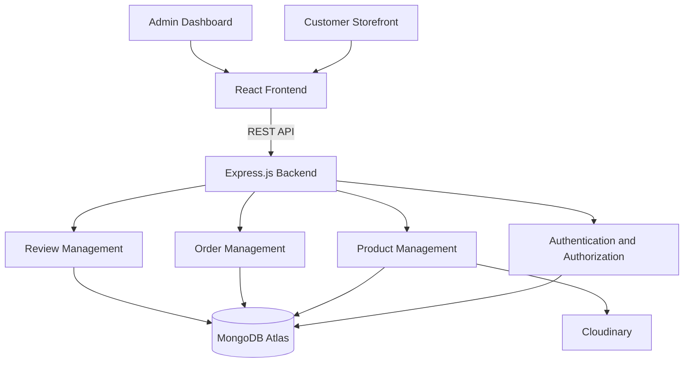
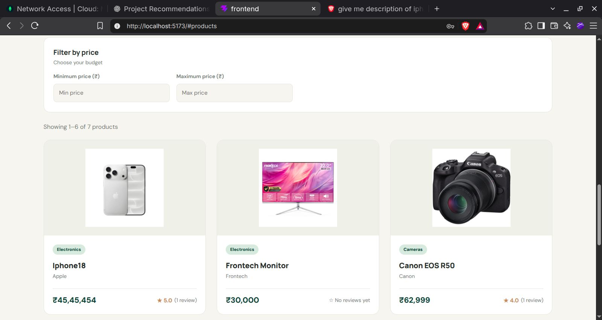
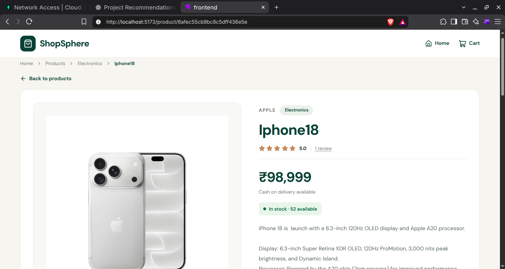
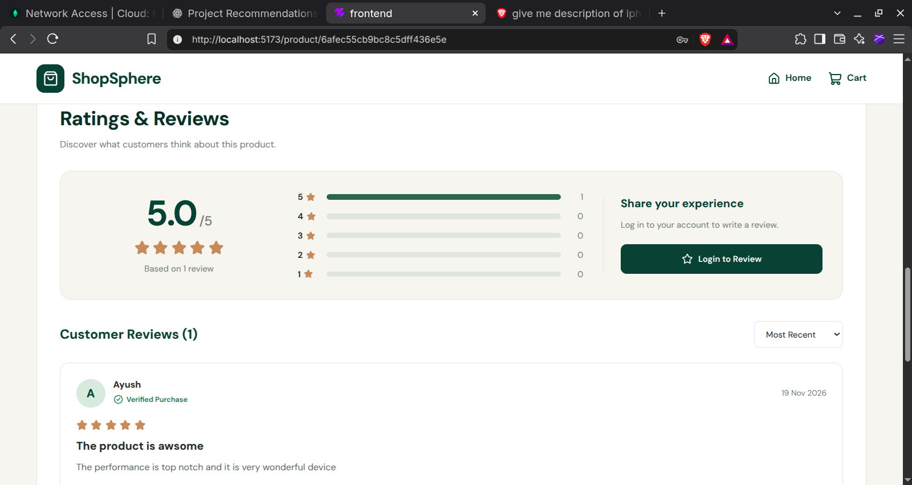
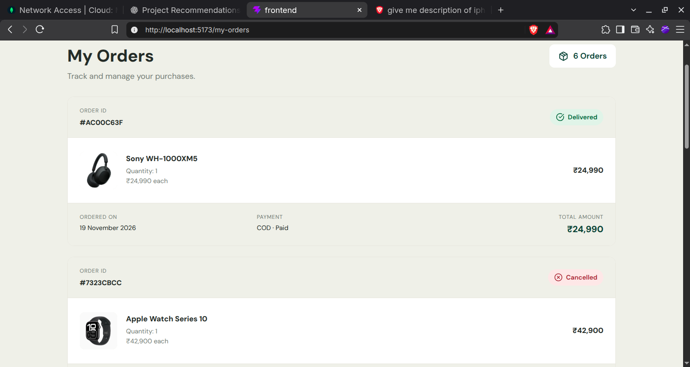
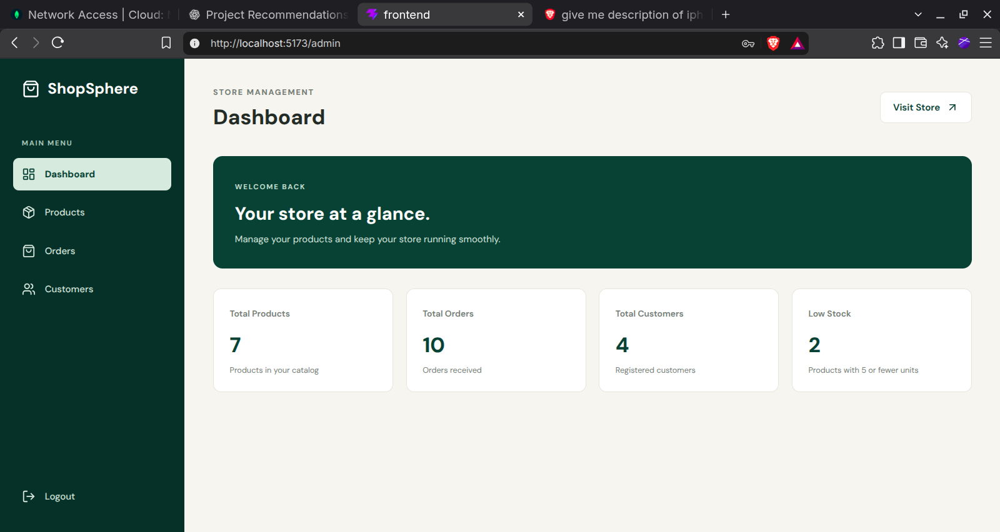
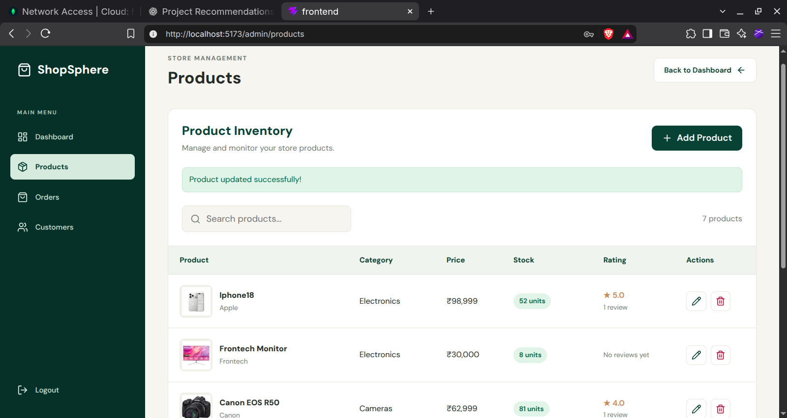
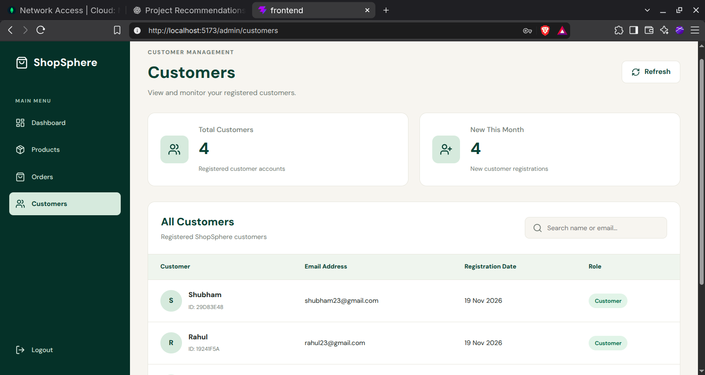

# 🛒 ShopSphere

A modern, full-stack e-commerce platform built using the MERN stack, featuring a responsive customer storefront, secure authentication, inventory management, verified product reviews, and a comprehensive admin dashboard.

Developed as part of the Full-Stack Development Internship at CodeC Technologies.


## ✨ Features

### Customer Features

- Customer registration and JWT authentication
- Responsive and modern e-commerce storefront
- Product search, filtering, sorting, and pagination
- Detailed product pages with image galleries
- Persistent shopping cart
- Stock-aware quantity management
- Checkout with Cash on Delivery
- Order history and delivery status tracking
- Verified purchase reviews and ratings
- Review editing and deletion

### Admin Features

- Role-based admin authentication
- Administrative dashboard with business statistics
- Product creation, editing, and deletion
- Multiple product image uploads using Cloudinary
- Inventory and low-stock monitoring
- Order management and status updates
- Customer management
- Automatic stock deduction and restoration

### Security Features

- JWT-based authentication
- Password hashing using bcrypt
- Role-based access control
- Protected API routes
- Server-side input validation
- Helmet security headers
- API and authentication rate limiting
- Restricted CORS configuration
- Environment variable protection

## 🛠️ Tech Stack

### Frontend

- React.js
- Vite
- React Router
- Axios
- Lucide React
- CSS3

### Backend

- Node.js
- Express.js
- MongoDB Atlas
- Mongoose
- JSON Web Token
- bcryptjs
- Multer
- Cloudinary
- Helmet
- Express Rate Limit

## 🏗️ System Architecture



## 📸 Screenshots

### Customer Storefront

#### Homepage


#### Product Catalog



#### Product Details



#### Product Reviews



#### Shopping Cart


#### Checkout


#### My Orders



### Admin Panel

#### Admin Dashboard



#### Admin Orders



#### Admin Customers



## 📁 Project Structure

```text
ShopSphere/
├── backend/
│   ├── config/
│   ├── controllers/
│   ├── middleware/
│   ├── models/
│   ├── routes/
│   ├── scripts/
│   ├── .env.example
│   ├── package.json
│   └── server.js
├── frontend/
│   ├── public/
│   ├── src/
│   │   ├── assets/
│   │   ├── components/
│   │   ├── context/
│   │   ├── pages/
│   │   ├── App.jsx
│   │   └── main.jsx
│   ├── .env.example
│   └── package.json
├── screenshots/
├── .gitignore
└── README.md
```

## 🔌 API Endpoints

| Method | Endpoint                            | Access       |
| ------ | ----------------------------------- | ------------ |
| GET    | /api/health                         | Public       |
| POST   | /api/auth/register                  | Public       |
| POST   | /api/auth/login                     | Public       |
| GET    | /api/products                       | Public       |
| GET    | /api/products/:id                   | Public       |
| POST   | /api/products                       | Admin        |
| PUT    | /api/products/:id                   | Admin        |
| DELETE | /api/products/:id                   | Admin        |
| POST   | /api/products/upload                | Admin        |
| POST   | /api/orders                         | Customer     |
| GET    | /api/orders/my-orders               | Customer     |
| GET    | /api/orders/admin/all               | Admin        |
| PUT    | /api/orders/admin/:orderId/status   | Admin        |
| GET    | /api/auth/admin/customers           | Admin        |
| GET    | /api/auth/admin/customers/stats     | Admin        |
| GET    | /api/reviews/product/:productId     | Public       |
| GET    | /api/reviews/eligibility/:productId | Customer     |
| POST   | /api/reviews/product/:productId     | Customer     |
| PUT    | /api/reviews/:reviewId              | Review Owner |
| DELETE | /api/reviews/:reviewId              | Review Owner |

## 🚀 Getting Started

### Prerequisites

- Node.js compatible with the project dependencies
- npm
- MongoDB Atlas account
- Cloudinary account

### 1. Clone the Repository

```bash
git clone https://github.com/Tribalchiefcoder/ShopSphere.git
cd ShopSphere
```

### 2. Backend Setup

```bash
cd backend
npm install
cp .env.example .env
```

Configure the environment variables:

```env
PORT=5000
MONGO_URI=your_mongodb_connection_string
JWT_SECRET=your_secure_random_secret
CLOUDINARY_CLOUD_NAME=your_cloud_name
CLOUDINARY_API_KEY=your_api_key
CLOUDINARY_API_SECRET=your_api_secret
FRONTEND_URL=http://localhost:5173
NODE_ENV=development
```

Use a securely generated JWT secret of at least 32 bytes.

Start the backend:

```bash
npm run dev
```

### 3. Frontend Setup

Open a separate terminal:

```bash
cd ShopSphere/frontend
npm install
cp .env.example .env
```

Configure the frontend environment:

```env
VITE_API_URL=http://localhost:5000/api
```

Start the frontend:

```bash
npm run dev
```

### 4. Access the Application

- Customer Storefront: http://localhost:5173
- Admin Login: http://localhost:5173/admin/login
- Backend API: http://localhost:5000
- Health Check: http://localhost:5000/api/health

Admin access requires an authorized administrator account.

## 🌐 Deployment

- Frontend: Vercel (planned)
- Backend: Render (planned)
- Database: MongoDB Atlas
- Image Storage: Cloudinary

## 🎯 Learning Outcomes

- Full-stack MERN application development
- RESTful API design and integration
- Authentication and role-based authorization
- Database modeling and inventory management
- Cloud-based image storage
- Responsive user interface development
- Backend security and environment configuration

## 👨‍💻 Developer

Developed by Sumedh.

GitHub: [Tribalchiefcoder](https://github.com/Tribalchiefcoder)

---

⭐ If you find this project useful, consider starring the repository.
